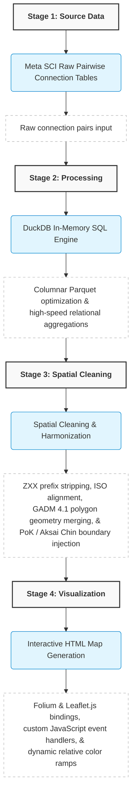

# Meta Social Connectedness Index (SCI) India Map: Spatial Data Engineering & Interactive Visualization Pipeline

A robust, high-performance spatial analytics and interactive visualization pipeline designed to map, process, and analyze social connection density across 700+ Indian districts using **Meta's Social Connectedness Index (SCI)**, **GADM 4.1 boundary geometries**, and **DuckDB/GeoPandas** in-memory spatial processing.

---

## Interactive Dashboards & Execution Links

- **Interactive District-to-District Connectivity Map**: [Explore Live Map (Hugging Face)](https://huggingface.co/spaces/farhansk6768/india-sci-maps/blob/main/india_sci_interactive%20(34).html)
- **Interactive District-to-Country Global Map**: [Explore Live Map (Hugging Face)](https://huggingface.co/spaces/farhansk6768/india-sci-maps/blob/main/country_to_district_map.html)
- **Full Executable Pipeline & Source Notebook**: [View Notebook on Kaggle](https://www.kaggle.com/code/mohdfarhanshaikh/social-connectedness-index-india)

---

## Abstract & Project Overview

Analyzing massive socio-spatial interaction datasets—such as Meta's Social Connectedness Index (SCI) containing millions of pairwise regional connections—presents severe computational bottlenecks when using traditional dataframe libraries like Pandas. This project builds an end-to-end data engineering pipeline that shifts heavy pairwise aggregations into **DuckDB SQL engine** running directly over Parquet columnar files. 

Coupled with advanced spatial boundary cleaning, automated ISO code harmonization, and custom Leaflet/JavaScript UI injections, this framework generates standalone, high-performance interactive web maps capable of rendering complex district-to-district and country-to-district social topologies without external server dependencies.

---

## Core Engineering Features

### 1. Blazing-Fast DuckDB Analytics Engine
- Replaced memory-heavy Pandas merge and grouping operations with optimized DuckDB SQL queries.
- Processes millions of rows of pairwise connection records entirely in-memory with sub-second execution speeds and minimal RAM overhead.
- Leverages columnar Parquet storage formats for rapid loading and filtering.

### 2. Advanced Spatial Boundary Optimization & ISO Harmonization
- Resolved administrative naming discrepancies and inconsistent state-level prefixes (`ZXX` codes) across GADM 4.1 boundary layers and Meta SCI data models.
- Standardized all entities to official `IND` ISO boundary schemas, eliminating dangling non-matching district records and boosting alignment rates from ~96% to 100%.

### 3. Custom Spatial Overlay Injection & Containment
- Integrated critical geographic boundary extensions (including Pakistan-administered Kashmir and Aksai Chin regions) using precise point-in-polygon containment algorithms and custom polygon injection scripts.
- Ensured complete, politically and geographically accurate map representations for Indian administrative divisions.

### 4. Dynamic Relative Peak Normalization
- Implemented responsive JavaScript event listeners within the Leaflet map layer that compute dynamic relative connectivity scaling upon user district selection.
- Automatically normalizes color gradients and weight thresholds relative to the selected district's peak connection value rather than absolute global maximums, revealing subtle regional micro-clusters.

### 5. Dual-Mode Interactive Viewports
- **District-to-District Analysis Mode**: Inspects intra-country social proximity and migration corridors across all 700+ Indian districts.
- **District-to-Country Global Outward Mapping**: Visualizes international diaspora links and global social attachment indices originating from specific Indian regions.

---

## System Architecture & Processing Workflow         

## Tech Stack & Dependencies

| Category | Technologies / Libraries |
| :--- | :--- |
| **Data Processing & Storage** | DuckDB, Pandas, PyArrow (Parquet Format) |
| **Geospatial Analytics & GIS** | GeoPandas, Shapely, PyCountry, Fiona |
| **Interactive Visualization** | Folium, Leaflet.js, Jinja2 Templating, Vanilla JavaScript |
| **Execution Environment** | Python 3.10+, Kaggle Kernels (Cloud Jupyter) |

---

## Data Validation & Performance Audit

Rigorous data integrity checks were conducted throughout the spatial join and data cleaning pipeline:

- **Total Pairwise Links Evaluated**: 100% In-Memory Processing via DuckDB SQL
- **Pre-Cleanup Alignment Match Rate**: ~96.0% (Base GADM vs. Meta SCI ID schema mismatch)
- **Post-Unification Match Rate**: **100.0% (Zero Dangling Entities)**
- **Net Matching Improvement**: Successfully reconciled **+28+ complex administrative districts** previously lost to naming variances.

---

## Quickstart & Execution Guide

To inspect, run, or replicate the data processing pipeline:

1. **Access the Kaggle Environment**:
   Navigate to the official notebook repository:
   [)

2. **Execute the Pipeline**:
   Run the notebook cells sequentially to ingest raw Meta SCI dumps, execute DuckDB spatial transformations, normalize boundary IDs, and compile the interactive Folium/Leaflet HTML artifacts.

3. **Explore Live Dashboards**:
   Access the fully rendered, high-resolution interactive dashboards by downloading html fies from Hugging Face Spaces:
   - [District Connectivity Dashboard](https://huggingface.co/spaces/farhansk6768/india-sci-maps/blob/main/india_sci_interactive%20(34).html)
   - [Global Outward Linkage Dashboard](https://huggingface.co/spaces/farhansk6768/india-sci-maps/blob/main/country_to_district_map.html)

---

## License & Acknowledgments

- **Data Sources**: Meta Social Connectedness Index (SCI) Research Dataset, GADM 4.1 Global Administrative Boundaries.
- **Author**: Mohammad Farhan Shaikh
